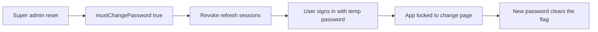

# Super admin password reset

Staff passwords today are set only on invite. There is no `mustChangePassword` field and no change-password API. DISHA (`references/PGDM Induction Program`) is the behavior reference: bcrypt hash, minimum 8 characters, confirm must match, checkbox defaults to on, and you cannot reset yourself.

Scope is **admin staff only** (the Users list). Students have no passwords. The student client stays unchanged.

## Who can do what

- **Reset someone else:** signed-in `super_admin` only. Full-access admins do not get the action. The target must be another user in the same organization. Resetting yourself is rejected; own password uses the other form.
- **Change own password:** `super_admin` only, from the sidebar. Fields: current, new, confirm.
- **Forced change:** any admin the checkbox was set for. After they sign in with the temporary password, every other page redirects to a change screen (new + confirm only, because they just authenticated). Success clears the flag and keeps them signed in.

## Reset other users

On [admin/src/pages/users.tsx](admin/src/pages/users.tsx), add a **Reset password** button beside the existing row actions when the actor is a super admin and `userId` is not their own. Thread `userId` through [admin/src/services/api-mappers.ts](admin/src/services/api-mappers.ts) and `AdminUser` in [admin/src/services/types.ts](admin/src/services/types.ts) (the API already returns it from `mapMembership`).

Dialog uses `FormDialog`, `Field`, `PasswordInput`, and `Checkbox` (same chrome as the user editor):

- New password and confirm password (both required, at least 8, at most 128, must match)
- Checkbox **Require password change at next login**, default checked
- Labels tied to inputs; errors on the fields; show/hide buttons keep their accessible names

`POST /api/users/:id/password` (`:id` is the membership id, same as edit/delete). `requireRole('super_admin')`. Body: `password`, `confirmPassword`, `mustChangePassword` (default `true`). Hash with existing `hashPassword` (bcrypt, 12 rounds). Write audit `user.password_reset` with the flag only, never the password.

## Change own password

In the sidebar footer of [admin/src/layouts/admin-layout.tsx](admin/src/layouts/admin-layout.tsx), next to Sign out (expanded sidebar only, same cluster), a **Change password** button for super admins opens a dialog:

- Current password, new password, confirm password
- Current must match; new must differ from current; new and confirm must match; length 8–128

`POST /api/auth/password` for any signed-in staff user (needed for the forced screen too):

- If `mustChangePassword` is false, `currentPassword` is required and checked
- If it is true, current password is not required
- New password is hashed, flag set to false
- Audit `user.password_change`

Voluntary success signs the super admin out and returns them to login (same outcome as DISHA profile). Forced success returns a new session and sends them to the dashboard.

## Change on next login

- Add `mustChangePassword Boolean @default(false) @map("must_change_password")` on `User` in [api/prisma/schema.prisma](api/prisma/schema.prisma) and a new SQL migration under `api/prisma/migrations/`.
- Include the flag on the session user payload ([api/src/modules/auth/service.ts](api/src/modules/auth/service.ts), [admin/src/contexts/auth-context.ts](admin/src/contexts/auth-context.ts)) and on the access JWT.
- New route `/change-password` inside the authenticated admin shell. [admin/src/contexts/require-auth.tsx](admin/src/contexts/require-auth.tsx) sends a flagged user there and blocks other paths until the flag is clear.
- While the JWT flag is true, API auth allows only password change, refresh, session, and sign-out.
- On any password write, revoke that user’s refresh-token families. [api/src/lib/refresh-tokens.ts](api/src/lib/refresh-tokens.ts) will index family ids by user id (today they cannot be found later). Also store a password epoch in Redis and on the access JWT so [api/src/middleware/auth.ts](api/src/middleware/auth.ts) rejects tokens issued before the change. Tokens from before this deploy have no epoch and keep working until they expire (access tokens last 15 minutes) or refresh (refresh is revoked).

## Checks

- `npm run typecheck` and `npm run lint` in `admin/` and `api/` for the files touched.
- Apply the migration against the dev database, then reuse the admin already on port 5173: reset another user with the checkbox on and off, confirm a non-super-admin cannot see the actions, and walk the super admin’s own change-password form including mismatched confirm and a wrong current password.
- Run `graphify update .` after the code change.