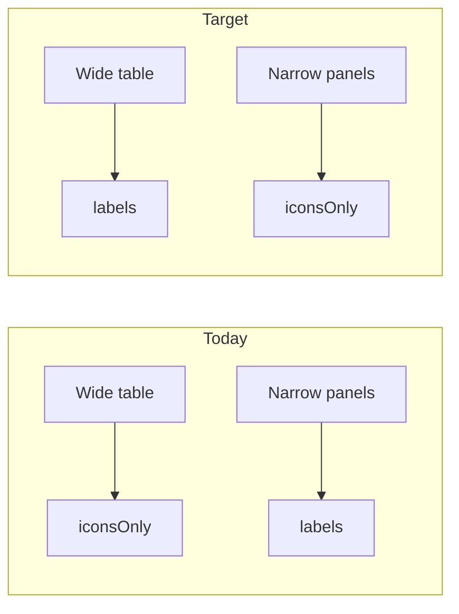

# List table actions and cell wrap

## Decisions (locked)

- **Desktop (container ≥720px):** labeled buttons (icon + text) — restore DESIGN intent.
- **Narrow panels (&lt;720px):** icon-only + tooltip/`aria-label`, sized to available space.
- **Dual deletes (1B):** different Lucide icons **and** different destructive weight — Delete registration = filled `destructive`; Delete attempt = `outline` + destructive text/border treatment.
- **Ellipsis (2):** all **list table cells** wrap full text (no `truncate` / forced single-line ellipsis on names, IDs, titles). Toolbar filter summaries and non-list chrome may keep truncate.

## Current problem

[`admin/src/components/row-actions.tsx`](admin/src/components/row-actions.tsx) is wired as `iconsOnly={!narrow}` on list pages — **wide = icons, narrow = labels** (inverted vs request and vs [`docs/design/DESIGN.md`](docs/design/DESIGN.md) L154). Both deletes share `TrashIcon` + filled destructive. [`admin/src/components/ui/table.tsx`](admin/src/components/ui/table.tsx) forces `whitespace-nowrap` on every cell.

## 1. Shared `RowActions`

Update [`admin/src/components/row-actions.tsx`](admin/src/components/row-actions.tsx):

- Flip call-site prop to `iconsOnly={narrow}` (see §2); update the JSDoc to match.
- **Wide:** `size="default"`, icon + label, `flex-wrap` / `gap-2`, no custom heights (keep `--control-h`).
- **Narrow:** `size="icon"`, tooltip + `aria-label`, compact `flex-wrap` so icons stay inside the panel (no horizontal page overflow).
- **Delete registration** (`removeRegistration`): icon e.g. `UserX` (or `ClipboardX`); `variant="destructive"` (filled).
- **Delete attempt** (`remove`): icon e.g. `FileX` (or `Eraser`); `variant="outline"` plus destructive-tinted classes (`text-destructive`, `border-destructive/40`, hover) so it reads as a second, lighter destructive — not a twin trash.
- Keep tooltips whenever `iconsOnly` so both deletes stay distinguishable without relying on color alone.

## 2. List page wiring

Change `iconsOnly={!narrow}` → `iconsOnly={narrow}` in:

- [`admin/src/pages/registrations.tsx`](admin/src/pages/registrations.tsx)
- [`admin/src/pages/activity-list.tsx`](admin/src/pages/activity-list.tsx)
- [`admin/src/pages/users.tsx`](admin/src/pages/users.tsx)
- [`admin/src/pages/participants.tsx`](admin/src/pages/participants.tsx)
- [`admin/src/pages/question-banks.tsx`](admin/src/pages/question-banks.tsx)

Leave [`bank-form.tsx`](admin/src/pages/bank-form.tsx) / [`quiz-questions-panel.tsx`](admin/src/pages/quiz-questions-panel.tsx) labeled (no `narrow` / always editor scroll table) unless they already expose container width — do not invent icon-only there without the same hook.

Participants extra actions (Copy link / Assign) stay beside `RowActions`; on narrow, match icon-only + tooltip pattern so the row action strip stays one consistent height and wrap.

## 3. List cell wrapping (no ellipsis)

- [`admin/src/components/ui/table.tsx`](admin/src/components/ui/table.tsx): change `TableCell` from `whitespace-nowrap` to allow wrap (`whitespace-normal` + `wrap-break-word` / `align-top` or `align-middle` as needed). Keep **header** `whitespace-nowrap` so column titles stay one line. Checkbox / actions columns can opt into `whitespace-nowrap` via `tableClassName` / head class when needed.
- Remove list-cell `truncate` in list renderers, notably [`activity-list.tsx`](admin/src/pages/activity-list.tsx) name/subtitle and [`participants.tsx`](admin/src/pages/participants.tsx) form link span — use `min-w-0 wrap-break-word` instead.
- Keep card horizontal scroll only when the **table** is still wider than the card (many columns); text inside cells must not ellipsis. No page-level overflow (shell already `min-w-0`).
- Do **not** strip truncate from toolbar multi-select summaries, sidebar, dialogs, or wizard chrome — out of “list table cells” scope.

## 4. Control consistency

No new heights or radii. Rely on existing [`admin/src/index.css`](admin/src/index.css) `--control-h: 44px` and button `rounded-lg` (8px). Adjust [`data-slot='record-actions'`](admin/src/index.css) rules (~632–643) so icon-only buttons stay square 44×44 and labeled buttons stay full-width in the panel grid without overlapping.

## 5. Docs

Update [`docs/design/DESIGN.md`](docs/design/DESIGN.md) Tables section (~L154): desktop View/Edit (and other row actions) = icon + label wrapping in the cell; below 720px container = icon-only with accessible names/tooltips; dual deletes differentiated by icon + destructive weight; list cells wrap (no ellipsis).

## 6. Verify

In `admin/`: `npm run typecheck`, `npm run lint`, `npm run format:check`. Spot-check Registrations (both deletes), Participants, Activity list at ~375 / ~768 / ~1280 (and container &lt;720 vs ≥720). Confirm no page horizontal overflow and no overlapping action buttons.

## Out of scope

- Assessment/quiz report rows (no `RowActions`).
- Participant app.
- Media card grids (Sponsors/Contests).
- Broader wizard / design-system truncate cleanup.
