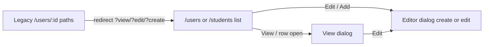

# Users + Students: shared FormDialog and Users page→dialog migration

## Current state
- **Students already dialog-only** on `/students` via [`student-view-dialog.tsx`](admin/src/pages/student-view-dialog.tsx) and [`student-editor-dialog.tsx`](admin/src/pages/student-editor-dialog.tsx). Whole `DialogContent` scrolls (`overflow-y-auto`), so the footer moves with content—this is what we polish.
- **Users still page-based**: list navigates to [`user-detail.tsx`](admin/src/pages/user-detail.tsx) (view/edit) and [`user-form.tsx`](admin/src/pages/user-form.tsx) (invite). Routes in [`app-routes.tsx`](admin/src/routes/app-routes.tsx) L122–127.

## Target UX



- Stay on the list URL; open dialogs via React state (same as students).
- Optional deep links: `?view=`, `?edit=`, `?create=1` then strip with `replace`.
- Legacy paths redirect into those query params (mirror `LegacyStudentRoute`).

## 1. Shared shell: `FormDialog`

Add [`admin/src/components/form-dialog.tsx`](admin/src/components/form-dialog.tsx) that wraps existing shadcn `Dialog` primitives (do **not** change default overflow on all dialogs in [`dialog.tsx`](admin/src/components/ui/dialog.tsx)—confirm / image-library stay as they are).

**Layout contract** (fixes sticky footer):
- `DialogContent`: `flex flex-col gap-0 overflow-hidden p-0` + `max-h-[min(40rem,calc(100dvh-2rem))]` + `w-[calc(100%-2rem)]` + `sm:max-w-lg` (overridable).
- Header: `shrink-0` + padding + optional bottom border; title/description; keeps room for the X close.
- Body: `min-h-0 flex-1 overflow-y-auto` + horizontal padding — **only this region scrolls**.
- Footer: `shrink-0` + top border + padding; uses existing `DialogFooter` stacking (`flex-col-reverse` → `sm:flex-row`).

**API (concrete):**
```tsx
FormDialog({
  open?: boolean;           // default true when mounted like student dialogs
  onOpenChange: (open: boolean) => void;
  title: string;
  description?: string;
  children: ReactNode;      // scrollable body
  footer: ReactNode;
  contentClassName?: string;
  busy?: boolean;           // ignore outside/Escape close while saving
})
```

Tokens only (`border-border`, `bg-popover`, etc.). No new palette. Document in [`docs/design/DESIGN.md`](docs/design/DESIGN.md) §4 mapping: record create/view/edit → `FormDialog`.

## 2. Polish student dialogs (behavior unchanged)

Refactor both student dialogs to render through `FormDialog`:
- Same fields, validation, `useLeaveGuard` + discard confirm, `getStudent` / `createStudent` / `updateStudent`, toasts, Edit from view.
- Move footer actions into `footer` prop so Cancel / Save / Close stay pinned while fields scroll.
- Loading: keep disabled inputs / disabled Save while edit load runs (no full-page skeleton).

No route or list-page behavior changes beyond using the polished dialogs.

## 3. Users → dialogs (full parity with students)

### New files
- [`admin/src/pages/user-view-dialog.tsx`](admin/src/pages/user-view-dialog.tsx) — read-only: name, email, role (text), assessment/quiz access, status. Close + Edit when `canEdit`. Prefer **list row** `AdminUser` (like students); no extra fetch required for view.
- [`admin/src/pages/user-editor-dialog.tsx`](admin/src/pages/user-editor-dialog.tsx) — `mode: 'create' | 'edit'`:
  - **create (invite):** name*, email*, password* (min 8), role, assessment/quiz access → `inviteUser` (same payload as today’s form).
  - **edit:** load `getUser(userId)`; name*, email*, assessment/quiz access, status → `updateMembershipAccess`; keep **Deactivate** confirm → `deactivateMembership` when status is Active; role shown read-only in description (not editable), matching current detail page.
  - Dirty leave-guard + discard confirm on close; block close while `saving`.

### Wire [`users.tsx`](admin/src/pages/users.tsx)
Mirror students:
- `editor: string | null` (`'create'` | userId), `viewId: string | null`
- Add User → `setEditor('create')` (button, not `Link`)
- `RowActions` / row open → `onClick` setters (not `to:`)
- View → Edit closes view then opens editor
- `useSearchParams` for `view` / `edit` / `create=1` with `canManage` gates
- Mount dialogs beside the list (including skeleton branch so deep links work while loading)

### Routes + meta
In [`app-routes.tsx`](admin/src/routes/app-routes.tsx):
- Keep `/users` → `UsersPage`
- Replace page routes with redirects (gate create/edit like today):
  - `users/new` → `/users?create=1` under `manageUsersOrSettings`
  - `users/:userId/edit` → `/users?edit=:id` under same gate
  - `users/:userId` → `/users?view=:id`
- Drop lazy imports for `UserFormPage` / `UserDetailPage`

In [`meta.ts`](admin/src/routes/meta.ts): remove `/users/new` entry and the `/users/:id` view/edit regex branches (list meta only, like students).

### Delete after wiring
- [`admin/src/pages/user-detail.tsx`](admin/src/pages/user-detail.tsx)
- [`admin/src/pages/user-form.tsx`](admin/src/pages/user-form.tsx)

## 4. Preserve explicitly
| Concern | Keep |
|---|---|
| Permissions | View: any authenticated list visitor; create/edit/deactivate: `canManageUsersOrSettings` |
| Services | `inviteUser`, `getUser`, `updateMembershipAccess`, `deactivateMembership` (existing `invalidateAdmin(['users'])`) |
| Validation | Required name/email; invite password minLength 8; edit toast if empty name/email |
| Leave guard | Dirty editor + discard confirm; `allowLeave` after successful save/deactivate |
| List chrome | Toolbar, selection, Upload disabled, KPIs/columns unchanged |
| Students | No field/API/permission changes—shell polish only |

## 5. Verify
- `npm run typecheck`, `lint`, `format:check` in `admin/`
- `graphify update .`
- Manual on existing **5173** if up: Students + Users at ~375 / ~768 / ~1280 — footer fixed while body scrolls; invite/view/edit/deactivate; legacy `/users/:id` and `/users/new` land on dialogs; Escape/overlay respect dirty + busy

## Out of scope
- Sponsors/contests/banks still on pages
- Changing access model, role editing on update, or Upload Users
- Restyling unrelated dialogs (confirm, image library, bank question) unless they later adopt `FormDialog` voluntarily
