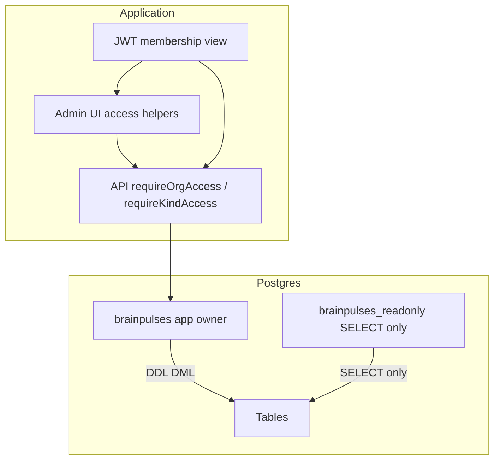

# View-only app hardening + Postgres readonly role

## Decisions (locked)

- **App membership** `viewer@brainpulses.com` (`assessmentAccess`/`quizAccess` = `view`) must not see or reach create/edit/invite/publish/settings DML in admin; API must keep rejecting mutations at the route layer.
- **Postgres**: Do **not** REVOKE from `brainpulses` (API/Prisma/migrations owner). Create and lock down a **new** role `brainpulses_readonly` on DB `brainpulses`, schema `public`, with `ALTER DEFAULT PRIVILEGES FOR ROLE brainpulses` so future Prisma tables stay SELECT-only for the readonly role.
- Script lives at [`docs/ops/postgres-readonly-role.sql`](docs/ops/postgres-readonly-role.sql); apply once via `docker exec` against the running stack. Document connection string and validation queries in [`docs/handoff/LOCAL_PRODUCTION.md`](docs/handoff/LOCAL_PRODUCTION.md).



## 1. Admin access helpers + UI/route gates

Add [`admin/src/lib/access.ts`](admin/src/lib/access.ts) mirroring API ranks (`none` &lt; `view` &lt; `edit` &lt; `full`; `super_admin` bypass):

- `canEditKind(membership, 'assessment'|'quiz')` — rank ≥ `edit`
- `canFullKind(...)` — rank ≥ `full`
- `canMutateOrg(membership)` — `super_admin` **or** max(assessment, quiz) ≥ `edit` (students create/update)
- `canManageUsersOrSettings(membership)` — `super_admin` **or** max ≥ `full` (invite/users/settings patch; matches API)

Wire into pages (hide `PageHeaderActions`, Edit kebabs, dashboard quick links; keep View):

- Lists: [`activity-list.tsx`](admin/src/pages/activity-list.tsx), [`question-banks.tsx`](admin/src/pages/question-banks.tsx), [`registrations.tsx`](admin/src/pages/registrations.tsx), [`students.tsx`](admin/src/pages/students.tsx), [`users.tsx`](admin/src/pages/users.tsx)
- Dashboard: [`dashboard.tsx`](admin/src/pages/dashboard.tsx)
- Settings write controls: [`settings-general.tsx`](admin/src/pages/settings-general.tsx), [`settings-system.tsx`](admin/src/pages/settings-system.tsx), [`settings-notifications.tsx`](admin/src/pages/settings-notifications.tsx), [`settings-access.tsx`](admin/src/pages/settings-access.tsx) — read-only display when no manage rights
- Sidebar: optionally hide Settings → User & Access for viewers in [`admin-layout.tsx`](admin/src/layouts/admin-layout.tsx)

Add [`RequireAccess`](admin/src/contexts/require-access.tsx) (or extend require-auth) and wrap mutation routes in [`admin/src/routes/index.tsx`](admin/src/routes/index.tsx): `/assessments/new`, `/quizzes/new`, bank create, registration assign, student/user create+edit — redirect to list with toast when insufficient rank. Form pages also no-op submit if somehow reached.

## 2. API route-layer completeness (defense in depth)

Service asserts already block viewer mutations; close route gaps so rejection happens before handlers:

- [`api/src/modules/activities/routes.ts`](api/src/modules/activities/routes.ts): add `requireKindAccess` on `GET/PATCH /:id`, `publish`, `archive` (view / edit / full / full) — load kind from activity in a thin middleware or keep service assert and add org-max `requireOrgAccess('edit'|'full')` where kind is unknown at route parse time. Prefer: wrap mutations with `requireOrgAccess('edit')` for PATCH and `requireOrgAccess('full')` for publish/archive **plus** existing `assertActivityAccess` (viewer’s max is view → 403 at middleware).
- [`api/src/modules/banks/routes.ts`](api/src/modules/banks/routes.ts): same pattern for `PATCH`, questions, import (`edit`).

Extend tests in [`api/test/security.test.ts`](api/test/security.test.ts) / [`api/test/tenancy.test.ts`](api/test/tenancy.test.ts): viewer 403 on activity PATCH/publish and bank PATCH; allow `GET` lists. Add a focused admin unit or smoke check that access helpers treat `view` as non-mutating.

## 3. Postgres readonly role script + apply

Create [`docs/ops/postgres-readonly-role.sql`](docs/ops/postgres-readonly-role.sql):

1. `REVOKE ALL` on database, schema, tables, sequences, functions, routines from `brainpulses_readonly` (idempotent; create role if missing with `LOGIN` + password from env placeholder).
2. `GRANT CONNECT` on DB `brainpulses`; `GRANT USAGE` on schema `public`; **no** `CREATE` on schema.
3. `GRANT SELECT` on all tables and sequences in `public`.
4. `ALTER DEFAULT PRIVILEGES FOR ROLE brainpulses IN SCHEMA public GRANT SELECT ON TABLES/SEQUENCES TO brainpulses_readonly`.
5. Validation block (comments + runnable checks): `SET ROLE` / `\c` as readonly → `SELECT` succeeds; `INSERT`/`UPDATE`/`CREATE TABLE` fail.

Apply against Docker (as owner `brainpulses`):

```powershell
Get-Content docs/ops/postgres-readonly-role.sql | docker exec -i brainpulses-postgres psql -U brainpulses -d brainpulses
```

Password for the new role: set in script via `\set` or document default `brainpulses_ro` for local only; never change app `DATABASE_URL`.

## 4. Docs + verification

- Update [`docs/handoff/LOCAL_PRODUCTION.md`](docs/handoff/LOCAL_PRODUCTION.md) and briefly [`README.md`](README.md): viewer UI is read-only; optional `brainpulses_readonly` for BI; app stays on `brainpulses`.
- Verify: `npm run typecheck` / `lint` in `admin/`; `npm run test` in `api/` (security + tenancy); manual sign-in as viewer — no Create/Add/Save buttons; API still 403 on POST; SQL validation queries pass for `brainpulses_readonly`.
