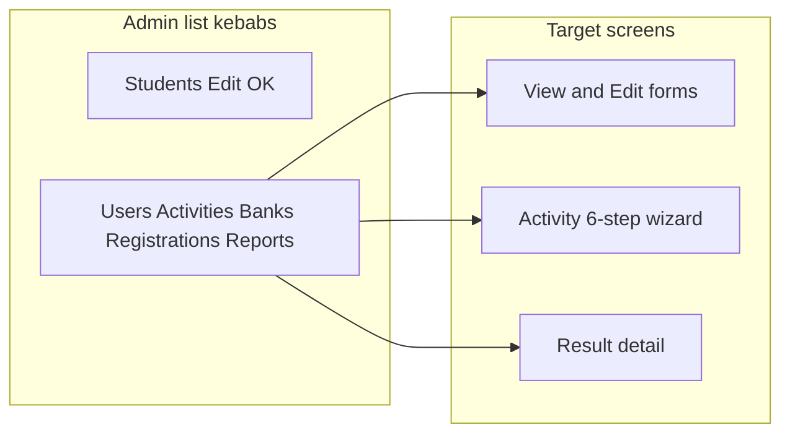

# View, Edit, and Results screens (admin + client)

## Decisions locked

- **Scope:** Admin View/Edit for all list entities **and** student client gaps (option C), executed in phases.
- **Activities:** Full 6-step wizard for create, edit, and view — not Basic Details only.

## Current gaps (inventory)

**Admin — only Students Edit is wired.** Dead kebab View/Edit on Users, Assessments, Quizzes, Question Banks, Registrations; dead “View result” on Reports. No detail routes except `/students/:id/edit`. Shared [`admin/src/components/row-actions.tsx`](admin/src/components/row-actions.tsx) is unused.

**API vs admin services**

| Entity | API get/update | Admin client gap |
|--------|----------------|------------------|
| Students | GET/PATCH `/:id` | OK (`getStudent` / `updateStudent`) |
| Users | PATCH membership only; **no GET by id** | No `getUser`; edit UI missing |
| Activities | GET/PATCH `/:id` + `bankIds`, duration, presentation, publish | No `getActivity` / `updateActivity` |
| Banks | GET/PATCH `/:id` | No `getQuestionBank` (update exists) |
| Registrations | List + assign/unassign only | No detail CRUD |
| Results | GET `/:id` + publish/regrade | No `getResult`; regrade unused |

**Activity wizard reality:** UI lists 6 steps in [`create-activity.tsx`](admin/src/pages/create-activity.tsx); only step 1 saves. Prisma `Activity` already has banks + behaviour fields (`durationMinutes`, `passingPercent`, `presentation`). **No** registration-form or assignment-rules columns yet — those need a small schema/API addition for a true full wizard.

**Student client:** Core library → attempt → `/results/:id` works. Gaps: no pre-start detail, quiz-biased CTAs, `latestResultId` null edge case, explanations unused.

---

## Phase 0 — Shared plumbing

- Add admin service helpers in [`admin/src/services/index.ts`](admin/src/services/index.ts): `getActivity`, `updateActivity`, `getQuestionBank`, `getResult`; user load via list hydrate or new `GET /api/users/:id` (prefer adding GET for clean View).
- Extend [`resolvePageMeta`](admin/src/routes/meta.ts) for all new dynamic paths (same pattern as student edit).
- Pattern for forms: follow [`student-form.tsx`](admin/src/pages/student-form.tsx) — `mode: 'create' | 'edit' | 'view'`, load on edit/view, read-only controls in view, Edit gated by existing access helpers (`canMutateOrg`, `canEditKind`, `canManageUsersOrSettings`).
- Wire kebabs with `Link` / `asChild` (Students Edit pattern); remove dead bare `DropdownMenuItem`s.

---

## Phase 1 — Activity full wizard (create / edit / view)

**Routes** (assessment + quiz):

- Keep `/assessments/new`, `/quizzes/new`
- Add `/:kind/:activityId` (view), `/:kind/:activityId/edit`
- Refactor create page into one `ActivityWizardPage` with `mode` + `kind`

**Backend for steps without fields today**

- Add `Activity.settings` JSON (Zod-validated) for:
  - **Registration Form:** ordered field defs (label, key, required, type) — admin-configured; student start can show them later if client phase needs it
  - **Assignment Rules:** mode `manual` | `all_active_students` (+ optional notes); “all” triggers assign via existing registration APIs on publish/save
- Persist steps that already exist without migration: **banks** (`bankIds`), **behaviour** (`durationMinutes`, `passingPercent`, `presentation`), **basic** (name, subtitle, dates, code), **publish** (`POST .../publish`)

**Wizard UX**

- Real step state (not chrome-only): Next/Back persist draft via create-then-PATCH (or PATCH when editing).
- Step 3: multi-select from `getQuestionBanks(kind)`.
- Step 5: duration, pass %, presentation select.
- Step 6: summary + Save draft / Publish / Archive (access-gated).
- View mode: all steps readable, primary action “Edit” if permitted.

**List wiring:** Activity list View → detail; Edit → edit wizard.

---

## Phase 2 — Remaining admin View / Edit / Results

| Surface | Routes | Implementation |
|---------|--------|----------------|
| Students | Add `/students/:id` view | Read-only `StudentFormPage`; keep edit |
| Users | `/users/:id`, `/users/:id/edit` | View profile + access; Edit = membership PATCH (`updateMembershipAccess`) + deactivate; add `GET /api/users/:id` if needed |
| Banks | `.../banks/:bankId`, `.../edit` | Extend [`bank-form.tsx`](admin/src/pages/bank-form.tsx) with load/update + question list |
| Registrations | `.../registrations/:registrationId` | View composite row (student + activity + status); Edit = unassign / re-status via existing assign APIs (no fake PATCH) |
| Reports | `.../reports/:resultId` | Result detail: score, student, activity, publish/regrade actions; wire “View result” `Link` |

Gates mirror create routes (`RequireAccess`). Kind-shared pages stay one component with `kind` prop.

---

## Phase 3 — Student client gaps

- **Pre-start / activity detail:** `/quizzes/:activityId` and `/assessments/:activityId` (or shared `/activities/:id`) showing instructions, schedule, duration; Start/Resume CTAs only from there. Library card primary → detail (or Start still allowed but copy aligned).
- **Kind-aware CTAs:** Dashboard / results “Continue / Find / Browse” respect assessment vs quiz (not always `/quizzes`).
- **Completed without `latestResultId`:** Prefer results list filtered by activity, or disable Start; never open a new attempt by mistake.
- **Explanations:** Render when API returns them; if API hardcodes `null`, fix student-portal mapping in the same phase if cheap.
- Leave `App.handoff.tsx` as non-runtime reference.

---

## Phase 4 — Hardening

- Loading/empty/error states matching existing skeletons.
- `npm run typecheck` / `lint` / `format:check` in `admin/` (and `client/` when touched).
- Manual pass: each kebab View/Edit, activity wizard all steps, report View result, student library → detail → attempt → result.
- `graphify update .` after code changes.

---

## Out of scope (explicit)

- Bulk upload / export buttons that are already `disabled`.
- Replacing notifications bell stub with a full inbox.
- Practice mode from handoff (unless a later iteration asks).
- Building a second design system; reuse admin chrome and client tokens as today.

## Execution order

Ship **Phase 0 → 1 → 2 → 3 → 4** so activity Edit is not wired until the full wizard works, then clear the other dead admin actions, then client.
