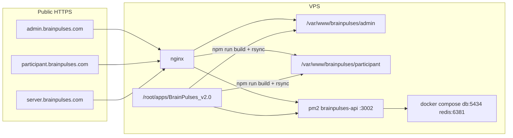

# VPS production deploy (API + Admin + Participant)

## Target topology



| Surface | Source | Runtime |
|---|---|---|
| API | [`api/`](api/) built to `dist/` | PM2 (`ecosystem.config.cjs`), bind `127.0.0.1:3002` (nginx terminates TLS) |
| Admin | [`admin/`](admin/) `npm run build` → `dist/` | Static files at `/var/www/brainpulses/admin` |
| Participant | [`participant/`](participant/) (not legacy [`client/`](client/)) | Static files at `/var/www/brainpulses/participant` |
| Data | [`docker-compose.yml`](docker-compose.yml) | Postgres `127.0.0.1:5434`, Redis `127.0.0.1:6381` only |

**Defaults locked:** Ubuntu LTS + nginx + Certbot; no GitHub Actions; no `prisma db seed` on production; CloudBeaver/RedisInsight off in production; Node **22+**.

## Why this matches the code

- API loads [`api/.env.prod`](api/src/config/load-env.ts) when `NODE_ENV=production` (else `.env`). PM2 must start with `--env production` so [`api/ecosystem.config.cjs`](api/ecosystem.config.cjs) sets that.
- Production startup requires Redis, `COOKIE_SECURE=true`, JWT ≥32 chars, and Twilio ([`api/src/config/env.ts`](api/src/config/env.ts)).
- Admin refresh cookie is `bp_refresh` on path `/api/auth` with `SameSite=lax` — works across `admin.` / `server.` / `participant.` on `brainpulses.com` over HTTPS. Nginx must proxy `/api` and `/health` on `server.brainpulses.com`, with `TRUST_PROXY=1`.
- SPA builds bake `VITE_*` at build time. Dev uses the Vite `/api` proxy; production needs absolute `VITE_API_URL=https://server.brainpulses.com`. Admin also needs `VITE_PARTICIPANT_ORIGIN=https://participant.brainpulses.com` for registration links.
- Uploads live under `api/uploads` (PM2 `cwd`). Deploys must never wipe that directory.

## Repo deliverables (implement after plan approval)

1. **Harden PM2** — [`api/ecosystem.config.cjs`](api/ecosystem.config.cjs): keep `cwd` `/root/apps/BrainPulses_v2.0/api`; set `env_production.NODE_ENV=production`; add `error_file` / `out_file` under `api/logs/`; `kill_timeout`, `max_restarts`, `exp_backoff_restart_delay`; document `pm2 start … --env production`.
2. **Docker Compose production profile** — keep current loopback ports; add Compose `profiles` so `redisinsight` / `cloudbeaver` are **not** started by default in prod (`docker compose --profile tools up` for optional admin UIs). Document strong passwords via root `.env` (from [`.env.example`](.env.example)). Optional thin [`docker-compose.prod.yml`](docker-compose.prod.yml) only if profile alone is unclear.
3. **Env templates**
   - Update [`api/.env.prod.example`](api/.env.prod.example) with real domain placeholders: `CORS_ORIGIN=https://admin.brainpulses.com,https://participant.brainpulses.com`, `HOST=127.0.0.1`, `TRUST_PROXY=1`, `DATABASE_URL=…@127.0.0.1:5434/…`, `REDIS_URL=redis://:…@127.0.0.1:6381`.
   - Add `admin/.env.production.example` and `participant/.env.production.example` (`VITE_API_URL`, admin `VITE_PARTICIPANT_ORIGIN`, `VITE_USE_FIXTURES=false`).
4. **Ops guide + nginx samples** under [`docs/ops/`](docs/ops/):
   - `DEPLOY.md` — full first-time + update runbook
   - `nginx/server.brainpulses.com.conf`, `admin.….conf`, `participant.….conf` (TLS stubs + SPA `try_files` + API proxy headers)
5. **Deploy script** — `docs/ops/deploy.sh` (bash on the VPS): `git pull` → `npm ci` (api/admin/participant) → `prisma migrate deploy` → `npm run build` (api) → `pm2 reload` → build SPAs with production env → atomic `rsync -a --delete` into `/var/www/brainpulses/{admin,participant}`.
6. **Root script hygiene** — extend [`package.json`](package.json) `cleaninstall` / notes so participant is first-class for deploy (client remains local/legacy only).

## First-time VPS bootstrap (guide content)

1. DNS A/AAAA for `server`, `admin`, `participant` → VPS IP.
2. Install Node 22, Docker + Compose plugin, nginx, certbot, pm2 (`npm i -g pm2`).
3. Clone repo to `/root/apps/BrainPulses_v2.0`.
4. Create root `.env` (Compose secrets) and `api/.env.prod` from the updated example; create `admin/.env.production` and `participant/.env.production`.
5. `docker compose up -d db redis` — wait for healthy; confirm only loopback listeners on 5434/6381.
6. `npm ci --prefix api` → `npm run prisma:deploy --prefix api` (**no seed**). Create the first admin user via a controlled path (seed is demo-only; guide will call out creating a real super-admin separately if no prod bootstrap script exists yet).
7. `npm run build --prefix api` → `pm2 start api/ecosystem.config.cjs --env production` → `pm2 save` + `pm2 startup`.
8. Build admin + participant → publish to `/var/www/brainpulses/{admin,participant}`.
9. Install nginx site configs; `certbot --nginx` for the three hosts.
10. Smoke: `https://server.brainpulses.com/health` and `/health/ready`; open admin and participant logins; confirm CORS + refresh cookie on admin.

## Update / redeploy runbook (every release)

```bash
cd /root/apps/BrainPulses_v2.0
git pull
# optional: stash-check that .env.prod and SPA .env.production were not overwritten
./docs/ops/deploy.sh   # or the documented manual steps
```

Manual equivalent the guide will spell out:

1. `npm ci` in `api`, `admin`, `participant`
2. `npm run prisma:deploy --prefix api` (never `migrate reset` / never rewrite applied migrations)
3. `npm run build --prefix api` → `pm2 reload brainpulses-api --env production` (or `pm2 restart` if reload is insufficient)
4. Build SPAs (production env files present) → `rsync` to `/var/www/…`
5. Verify health + one admin refresh + one participant login

**Rollback:** keep previous SPA dirs as `admin.prev` / `participant.prev` before rsync; `pm2` can point at a prior git tag rebuild if needed; DB rollbacks are migrate-forward only.

## Nginx essentials (samples)

- **API host:** proxy `/api` and `/health` to `http://127.0.0.1:3002`; set `Host`, `X-Real-IP`, `X-Forwarded-For`, `X-Forwarded-Proto`; disable buffering for uploads if needed; large body size aligned with upload caps (~10MB+).
- **Admin / Participant:** `root` to the www dirs; `try_files $uri $uri/ /index.html`; long-cache hashed assets under `/assets/`; no-cache `index.html`.
- Firewall: public **80/443** only; do not publish 3002 / 5434 / 6381.

## Production env checklist (copy into guide)

**API `.env.prod`:** `NODE_ENV=production`, `HOST=127.0.0.1`, `PORT=3002`, strong `DATABASE_URL` / `REDIS_URL`, `JWT_SECRET`, `CORS_ORIGIN` both SPA origins, `COOKIE_SECURE=true`, `COOKIE_SAME_SITE=lax`, `TRUST_PROXY=1`, Twilio set, `UPLOAD_DIR=./uploads`.

**Admin `.env.production`:** `VITE_API_URL=https://server.brainpulses.com`, `VITE_PARTICIPANT_ORIGIN=https://participant.brainpulses.com`, `VITE_USE_FIXTURES=false`.

**Participant `.env.production`:** `VITE_API_URL=https://server.brainpulses.com`.

## Ops extras (document, light touch)

- Backups: Postgres volume or `pg_dump` cron; Redis AOF already on; back up `api/uploads`.
- Logs: `pm2 logs brainpulses-api`; nginx access/error; Compose json-file rotation already in compose.
- Do not run CloudBeaver/RedisInsight on a public IP; if used, keep loopback + SSH tunnel only.

## Out of scope (explicit)

- GitHub Actions / CI deploy
- Migrating or shutting down legacy `client/`
- Changing product auth, Twilio provider, or adding MFA
