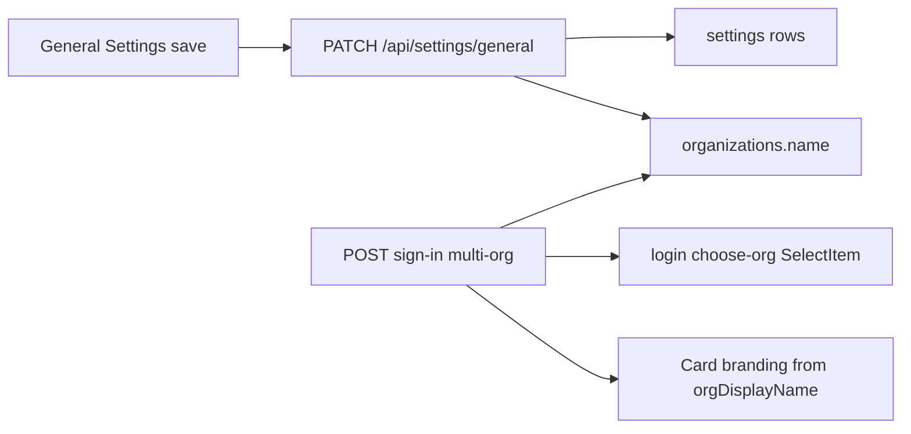

# Wire General Settings to the org picker

## Context

Today the choose-org step ([`admin/src/pages/login.tsx`](admin/src/pages/login.tsx)) renders `auth.organizations[].name` from sign-in:

```138:143:api/src/modules/auth/service.ts
    organizations: memberships.map((m) => ({
      id: m.organization.id,
      name: m.organization.name,
      slug: m.organization.slug,
      role: m.role,
    })),
```

That name is the Prisma [`Organization.name`](api/prisma/schema.prisma) column. General Settings instead writes `organizationName` / `orgDisplayName` into the `settings` table only — nothing else reads them.

## Mapping (chosen)

| Settings field | Key | Use on choose-org screen |
|---|---|---|
| **Organization name** | `organizationName` | Label in the Organization select (canonical `organizations.name`) |
| **Platform name** | `orgDisplayName` | Branding text on the choose-org card (replace hardcoded product wording) |



## API

In [`api/src/modules/settings/service.ts`](api/src/modules/settings/service.ts) `patchSettings`:

- When `values.organizationName` is a non-empty string, also `prisma.organization.update({ where: { id: organizationId }, data: { name: trimmed } })`.
- Keep writing the settings keys as today (no schema migration).

In `getSettings` for `general` (same file):

- After merging setting rows, overlay `organizationName` from the live `Organization.name` so the form matches the picker (Organization row is source of truth for that label).
- Keep `orgDisplayName` from settings (default `BrainPulses`).

No change needed to the sign-in membership query for the select labels — once `organizations.name` updates, picker labels update on next multi-org sign-in.

## Auth response for branding

Extend the multi-org sign-in payload so the choose-org screen can show platform name without a separate authenticated settings call (user is not tenant-scoped yet).

In [`api/src/modules/auth/service.ts`](api/src/modules/auth/service.ts) when returning `select_organization`:

- For each membership org, load `settings` key `orgDisplayName` (group `general`) or use default `BrainPulses`.
- Add `displayName` (or `platformName`) on each org option: `organizations: [{ id, name, slug, role, displayName }]`.

`name` stays the organization label; `displayName` is platform branding per org (useful when the user belongs to several tenants with different platform names).

## Admin UI

[`admin/src/contexts/auth-context.ts`](admin/src/contexts/auth-context.ts) — extend `OrgOption` with `displayName: string`.

[`admin/src/pages/login.tsx`](admin/src/pages/login.tsx) choose-org branch:

- Select items keep `{org.name}` (now reflects Organization name from settings).
- Card title/description use platform branding, e.g. title stays “Choose organization”; description or a short brand line uses the selected org’s `displayName`, falling back to the first org’s `displayName` before selection (or “BrainPulses” if missing).

[`admin/src/pages/settings-general.tsx`](admin/src/pages/settings-general.tsx):

- Update field hints to match reality: Organization name → “Shown when choosing an organization after sign-in.”; Platform name → “Shown on the organization chooser as product branding.”
- Save path unchanged (`patchSettingsGroup('general', …)`); server sync handles `organizations.name`.

## Checks

- Admin + API typecheck/lint on touched files.
- Manual: change Organization name → sign out → multi-org sign-in → new label in select; change Platform name → branding text updates on that screen.
- `graphify update .` after code changes.
