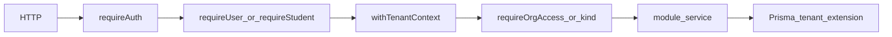

# Dependency map — critical flows

**Status:** Baseline evidence, 2026-10-23. Commit `ac881f3` on branch `fixes`.
**Reader job:** Trace five journeys from HTTP entry to persistence, including the failure status the code returns today.
**Limits:** This page does not replace [`api/openapi.yaml`](../../api/openapi.yaml), [`API_STRUCTURE.md`](API_STRUCTURE.md), or [`DB_STRUCTURE.md`](DB_STRUCTURE.md). It does not claim every route was executed in a browser. Status codes below are from the service and middleware source. Where an API test asserts the status, the test file is named.

Labels: **Verified** means read in source or observed in a command/test run on this date. **Unknown** means not executed here.

## Request stack

**Verified** in [`api/src/app.ts`](../../api/src/app.ts). Global order:

1. `requestId`
2. Helmet (CSP off; CORP `cross-origin`)
3. CORS with credentials (`createCorsOriginDelegate`)
4. `cookieParser`
5. JSON body, limit 2mb
6. `GET /health` and `GET /health/ready` (ready checks Postgres and Redis; 503 when either fails)
7. `/api` rate limit (auth paths skipped; skipped in `NODE_ENV=test` unless `ENABLE_RATE_LIMIT_IN_TEST=true`)
8. `/api` request timeout
9. `/api/auth` auth rate limit (skips `/refresh` and `/sign-out`), then `authRouter`
10. Feature routers, then `errorHandler`

Auth and tenant scope are per router, not global. [`withTenantContext`](../../api/src/middleware/auth.ts) stores `organizationId` in `AsyncLocalStorage`. The Prisma extension in [`api/src/lib/prisma.ts`](../../api/src/lib/prisma.ts) injects that id into tenant-model queries. A `where` or `create` that names a different organization throws a plain `Error`. That is not an `AppError`, so [`errorHandler`](../../api/src/middleware/error-handler.ts) returns **500** `INTERNAL_ERROR` and does not put a stack in the JSON. **Unknown:** whether any current route hits that throw. Cross-tenant reads covered by tests return **404** because the extension scopes the query, so the other tenant's row is not found.

`AppError` statuses used below: 400 `VALIDATION_ERROR`, 401 `UNAUTHORIZED`, 403 `FORBIDDEN`, 404 `NOT_FOUND`, 409 `CONFLICT`. Zod failures from the error handler are **422**.

Public auth routes skip `requireAuth`. Student attempt routes use `requireStudent` instead of `requireUser`.

## 1. Admin sign-in

**Verified** path: `POST /api/auth/sign-in` → `validate(signInSchema)` → [`auth/controller.ts`](../../api/src/modules/auth/controller.ts) → [`auth/service.ts`](../../api/src/modules/auth/service.ts) `signIn`.

| Outcome | Status | Evidence |
|---|---|---|
| Unknown email, inactive user, or bad password | 401 | Same message for all three (`Invalid email or password.`) |
| No active membership | 403 | `No active organization membership.` |
| One active membership | 200 `authenticated` | `issueSession` sets refresh cookie and access token |
| Several memberships | 200 `select_organization` | Short-lived org-select token; no session yet |
| `POST /api/auth/select-organization` with a bad token | 401 | |
| Selection for a membership the user does not have | 403 | |
| `POST /api/auth/refresh` with no cookie | 204 | Test in `api/test/auth.test.ts` |
| Refresh reuse or inactive membership | 401 | Cookie cleared; reuse revokes the family (`api/test/auth.test.ts`) |
| `GET /api/auth/session` without a user access token | 401 | `requireAuth` + `requireUser` |

The access token carries `organizationId`, `membershipId`, `role`, `assessmentAccess`, and `quizAccess`. Client-side role checks are not this boundary.

## 2. Student OTP and Unique ID

**Verified** path: public routes on `authRouter`.

| Route | Service | Failure |
|---|---|---|
| `POST /api/auth/student/sign-in-by-code` | `studentSignInByCode` | Unknown code **401**. Ambiguous phone/code across orgs without `organizationSlug` **400**. |
| `POST /api/auth/student/request-otp` and `resend-otp` | `studentRequestOtp` | Invalid phone **400**. Known student: OTP stored in Redis and SMS attempted. Unknown number: still `{ ok: true }` so the response does not reveal whether the number exists. Cooldown errors are swallowed outside `NODE_ENV=test`. |
| `POST /api/auth/student/verify-otp` | `studentVerifyOtp` | Bad, expired, or exhausted OTP **401**. Success issues a student session (`typ: student`, `sid`) and consumes the OTP. |
| `POST /api/auth/student/sign-out` | controller | Requires student access token. |

`requireAuth` for `typ: student` checks Redis via `isStudentSessionCurrent`. A stale `sid` is **401** `Session expired. Sign in again.` Tests: `api/test/auth.test.ts` (Unique ID, invalid phone, OTP round-trip). Browser OTP entry was **not** submitted during the UI capture.

## 3. Tenant-scoped student read

**Verified** path: `GET /api/students` and `GET /api/students/:id`.

`studentsRouter.use(requireAuth, requireUser, withTenantContext)`, then `requireOrgAccess('view')`, then [`students/controller.ts`](../../api/src/modules/students/controller.ts) → students service → Prisma.

| Outcome | Status | Evidence |
|---|---|---|
| Missing or non-user token | 401 | `requireUser` |
| User below `view` on both assessment and quiz access, and not `super_admin` | 403 | `requireOrgAccess` |
| Id from another organization | 404 | `api/test/tenancy.test.ts` `denies cross-tenant student read` |
| Same-org id | 200 | Not re-executed in the browser audit; list UI loaded for the signed-in org |

`super_admin` bypasses the access-rank check and still rides the token's `organizationId` into the tenant store.

## 4. Activity publish

**Verified** path: `POST /api/activities/:id/publish`.

Router: `requireAuth`, `requireUser`, `withTenantContext`, then `requireOrgAccess('full')`. Service: [`publishActivity`](../../api/src/modules/activities/service.ts).

| Outcome | Status | Evidence |
|---|---|---|
| Below `full` access | 403 | Route guard. `api/test/tenancy.test.ts` also blocks a view-only publish |
| Unknown id in this org | 404 | `Activity not found.` |
| Already `active` | 200 | Returns current activity; retry does not publish again |
| Status other than `draft` or `archived` | 400 | |
| Assessment with an empty round | 400 | |
| Quiz with no question bank | 400 | |
| Success | 200 | Status becomes `active`, audit `activity.publish`, dashboard cache invalidated |
| Same `idempotencyKey` already audited for this id | 200 | Returns `getActivity` and does not write again |

`assertActivityAccess` runs again in the service for the activity's kind, so org-wide `full` on the other kind is not enough.

## 5. Attempt start, save, submit

**Verified** path: [`api/src/modules/attempts/routes.ts`](../../api/src/modules/attempts/routes.ts).

`requireAuth`, `requireStudent`, `withTenantContext`, then:

| Route | Service | Notable failures |
|---|---|---|
| `POST /start` | `startAttempt` | Activity missing **404**. Not `active`, outside window, or student not `assigned` **403**. Assessment without `roundId` **400**. Previous round incomplete **403**. |
| `GET /:id/resume` | `resumeAttempt` | Missing attempt for this student **404** (service lookup). |
| `POST /:id/save` | `saveAttempt` | Not in progress, or revision mismatch, **409**. Update is conditional on `status`, `revision`, and `deadlineAt` inside a transaction. |
| `POST /:id/submit` | `submitAttempt` | Missing `Idempotency-Key` **400**. Same key with an existing result returns that result. A different key after submit **409** `Attempt already submitted.` |

Scoring uses server-side `scoreObjective` and question versions. Student visibility of score and answer key follows quiz settings in `submitAttemptInternal` (`scoreVisibleToStudent`, `answersVisibleToStudent`). Tests: `api/test/attempts.test.ts` (stale revision, idempotent submit, resume) and `api/test/scoring.test.ts`.

## Cross-layer edges

**Verified**

- Admin and client call the API through their own `api-client` modules. Admin data reads in [`admin/src/services/index.ts`](../../admin/src/services/index.ts) use fixtures only when `VITE_USE_FIXTURES=true`. The tracked example sets that flag to `false`.
- Admin routes live in [`admin/src/routes/index.tsx`](../../admin/src/routes/index.tsx). Client routes live in [`client/src/App.tsx`](../../client/src/App.tsx). Both wrap authenticated trees in `RequireAuth`.
- Controllers in activities, banks, and attempts call module services. They do not import Prisma.
- `api/graphify-out` and `graphify-out/` are generated and gitignored. Do not treat them as source.

**Unknown**

- Circular import graph was not computed with a bundler analyzer in this pass.
- No root `.github` workflow exists in this clone, so CI does not currently enforce this map.

**Recheck 2026-10-24, later the same day.** Route tracing closed the mismatch question. `withTenantContext` is the only `tenantStore.run` caller, and it uses `req.actor.organizationId`. Services and the audit router pass that same id. Organization selection and file download run outside tenant context. The throw stays as defense in depth and still becomes HTTP 500 if a future caller hits it. `createMany` rows are now passed through `withTenantOrganization`, which throws if the row names another organization instead of letting the row overwrite the injected id.
